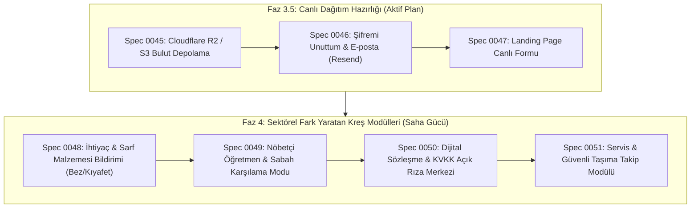

# 📊 KidsCare — Sektörel Kıyaslama, Pazar Araştırması ve Eksiklik Analizi (Gap Analysis)

> **Tarih:** 2026-10-16  
> **Kapsam:** Türkiye (MEB & Aile ve Sosyal Hizmetler Bakanlığı'na bağlı kreş/anaokulları) ve Küresel (Kinderpedia, Brightwheel, Procare, Kresim, Okul Defteri, Mutlu Çocuklar) Karşılaştırmalı Analizi.  
> **İlke:** Sıfır Pohpohlama & Dobra Ürün Filtresi (AGENTS.md Kural 5).

---

## 1. Yönetici Özeti (Pazar Konumlandırması)

KidsCare, multi-tenancy izolasyonu, dokunsal (claymorphic) tasarım dili, VSA mimarisi, hafif aidat/finans motoru ve istemci taraflı sunucusuz A4 PDF motoru ile teknik olarak rakiplerinin çok ilerisindedir.

Ancak bir kreş kurucusunun veya öğretmeninin kapısını çaldığımızda **günlük operasyonda karşısına çıkan ve veli krizine yol açan bazı spesifik saha pratikleri** bulunmaktadır. Bu belge, masadaki fikirlerin kaybolmaması ve ürünün adım adım Türkiye'nin en iyi kreş platformuna dönüşmesi için gereken yol haritasını somutlaştırır.

---

## 2. Pazardaki Oyuncular ve KidsCare Farkı

| Özellik / Kriter              | Standart Rakipler (Kresim, Okul Defteri vb.)      | Küresel Liderler (Brightwheel, Kinderpedia) | KidsCare (Mevcut Durum)                         | KidsCare Hedefi (V1 Tamamlanışı)                     |
| :---------------------------- | :------------------------------------------------ | :------------------------------------------ | :---------------------------------------------- | :--------------------------------------------------- |
| **Kullanıcı Arayüzü**         | 2010'lardan kalma hantal tablolar, çirkin formlar | Modern ama aşırı karmaşık SaaS ekranları    | Şık, dokunsal (tactile), eğlenceli ve modern    | Pazarın en hızlı ve sezgisel arayüzü                 |
| **Multi-Tenancy & Güvenlik**  | Zayıf ayrıştırma, veri sızıntısı riski            | Sağlam kurumsal mimari                      | PostgreSQL RLS + AsyncLocalStorage              | Kurumsal seviye %100 tenant garantisi                |
| **Aidat & Finans**            | Ya hiç yok ya da aşırı karmaşık ERP muhasebesi    | Stripe entegreli gelişmiş faturalama        | Hafif, tek tıkla tahsilat, gecikme uyarısı      | Kreş idarecisine özel pratik nakit/havale/kart takip |
| **Resmi Evrak / PDF**         | Sabit veya yetersiz çıktılar                      | Ücretli eklentiler                          | Sunucusuz istemci taraflı (@page CSS) A4 motoru | MEB & Bakanlık denetimine %100 hazır resmi şablonlar |
| **İlaç & Alerjen Eşleştirme** | Düz metin not kutusu                              | Alerji listesi                              | Akıllı otomatik AllergenMatcher + İlaç saati    | Sektörün en güvenli sağlık pasaportu                 |

---

## 3. Sahada Tespit Edilen Kritik Eksikler ve Çözüm Tanımları

### A. 🧷 Öğrenci İhtiyaç & Sarf Malzemesi Bildirimi (Bez, Islak Mendil, Kıyafet)

- **Sorun:** 1-4 yaş kreş gruplarında en sık veli iletişimi sarf malzemeleridir. Öğretmenler gün boyu WhatsApp'tan velilere _"Ali'nin bezi bitti", "Ayşe'nin yedek çorabı kalmadı"_ yazmaktan yorulur; veli unutur, çocuk mağdur olur.
- **Çözüm:** Öğrenci kartına / pasaportuna bağlı **"İhtiyaç Kutusu"**:
  - `Bebek Bezi (Kritik / Bitti)`
  - `Islak Mendil`
  - `Yedek Kıyafet / Çorap`
  - `Pişik Kremi / Güneş Kremi`
- **Etkileşim:** Öğretmen karne veya öğrenci listesinden tek tıkla _"İhtiyaç Bildir"_ butonuna basar. Veliye anında nazik bildirim gider: _"Ada'nın kreşteki yedek bezi bitmiştir. Lütfen yarın çantasına ekleyiniz."_

### B. ⏰ Nöbetçi Öğretmen / Sabah Karşılama & Akşam Geç Teslimat Modu

- **Sorun:** Kreşler 07:30 - 18:30 arası açıktır. Sınıf öğretmeni 08:30'da gelir. 07:30'da gelen çocukları tek bir "Nöbetçi Öğretmen" karşılar. Bizdeki sıkı sınıf izolasyonu nedeniyle nöbetçi öğretmen başka sınıfın öğrencisini teslim alamıyor veya sabah yoklamasını giremiyor.
- **Çözüm:**
  - Yönetici, personellerden birine o gün için **"Nöbetçi Öğretmen"** bayrağı atayabilir.
  - Nöbetçi öğretmen modunda sınıf filtresi kalkar; öğretmen kapıda tüm gelenleri karşılayabilir ve teslim alabilir. Saat 09:00 olunca sınıflar kendi öğretmenlerine otomatik devreder.

### C. 🚌 Servis & Güvenli Taşıma Takip Modülü (School Bus Tracking)

- **Sorun:** Velilerin en büyük korkusu: _"Çocuğum servise bindi mi, serviste unutuldu mu, okula sağ salim vardı mı?"_
- **Çözüm:**
  - Şoför veya servis hostesi için ultra sade 3 butonlu mobil ekran:
    1. `Öğrenci Servise Bindi` (Veliye bildirim: Servise bindi)
    2. `Okula / Sınıfa Teslim Edildi` (Veliye bildirim: Okula güvenle vardı)
    3. `Akşam Eve Teslim Edildi` (Veliye bildirim: Teslim edildi)
  - Veli sabah mazeret bildirdiyse servis listesinde otomatik _"Bugün Binmeyecek"_ olarak işaretlenir (servisin boşuna beklemesi engellenir).

### D. 💉 Aşı Takvimi & Periyodik Doktor/Hemşire Muayenesi

- **Sorun:** İl Sağlık ve MEB denetimlerinde çocukların aşı takip kartları ve kreş hekimi tarafından yapılan rutin boy/kilo/göz muayene kayıtları sorulur.
- **Çözüm:**
  - Öğrenci Pasaportuna `Aşı Takvimi` (Sağlık Bakanlığı çocuk aşı şablonu) ve `Periyodik Sağlık Kontrolü` formu eklenmesi.

### E. 📝 Dijital Sözleşme, KVKK & Fotoğraf Açık Rıza Onayları

- **Sorun:** Kreş kayıtlarında velilere kağıt ortamında 10 sayfa sözleşme imzalatılır (Fotoğraf paylaşım izni, gezi izin taahhüdü, KVKK açık rızası).
- **Çözüm:**
  - Veli portala ilk kez girdiğinde veya dönem başında tek tıkla dijital onay vereceği yasal metin modülü (`KVKK & Fotoğraf İzni`, `Kayıt ve Kabul Sözleşmesi`).

---

## 4. Rakiplerin Düştüğü Tuzaklar (KidsCare'de ASLA Yapılmayacaklar)

1. ❌ **Sosyal Medya Akışı & Yorumlaşma:** Velilerin birbirlerinin çocuklarına veya etkinliklere açık yorum yazması veli çatışmasına yol açar. Yorumlar kapalı, paylaşım tek yönlü kalmalıdır.
2. ❌ **Aşırı Karmaşık Çift Taraflı ERP Muhasebesi:** Kreş müdürü muhasebeci değildir; e-fatura kesimi için zaten muhasebecileri vardır. Bizim hafif aidat modülümüz kreşin ihtiyacı için mükemmel noktadadır.
3. ❌ **Canlı Kamera Yayınının Uygulama İçine Gömülmesi:** Yüksek bant genişliği maliyeti ve sunucu çökme riskine ek olarak, velilerde gereksiz kontrol takıntısı yaratır. Kamera harici DVR/IP üzerinden çözülmelidir.

---

## 5. Sıralı Uygulama Yol Haritası

